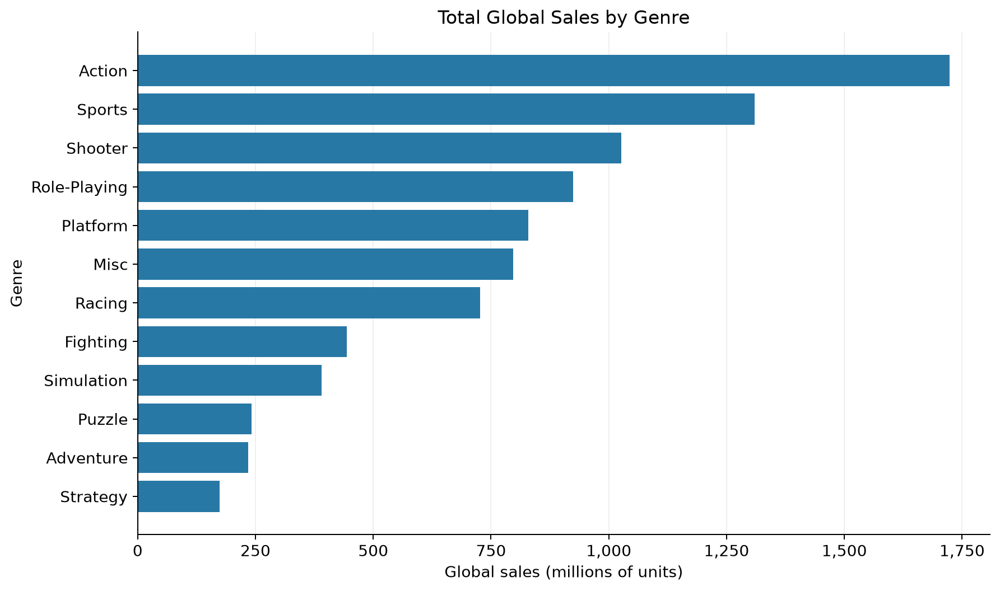
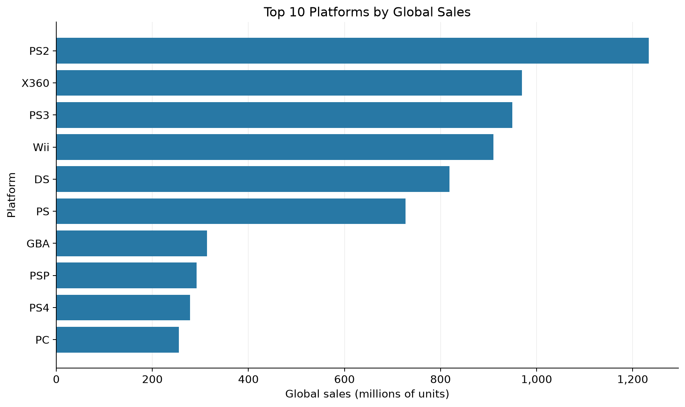
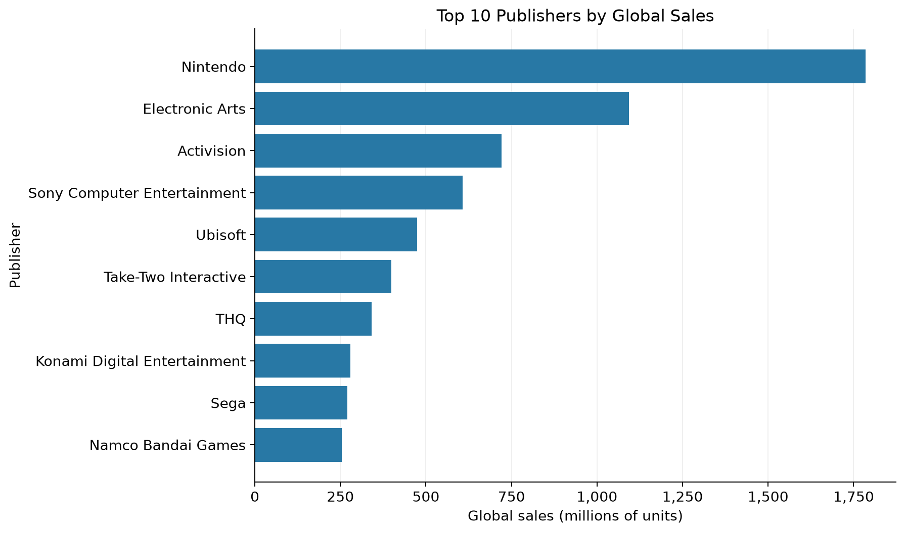
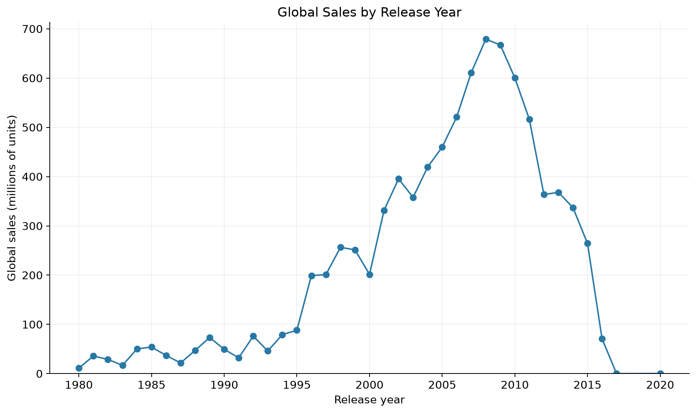
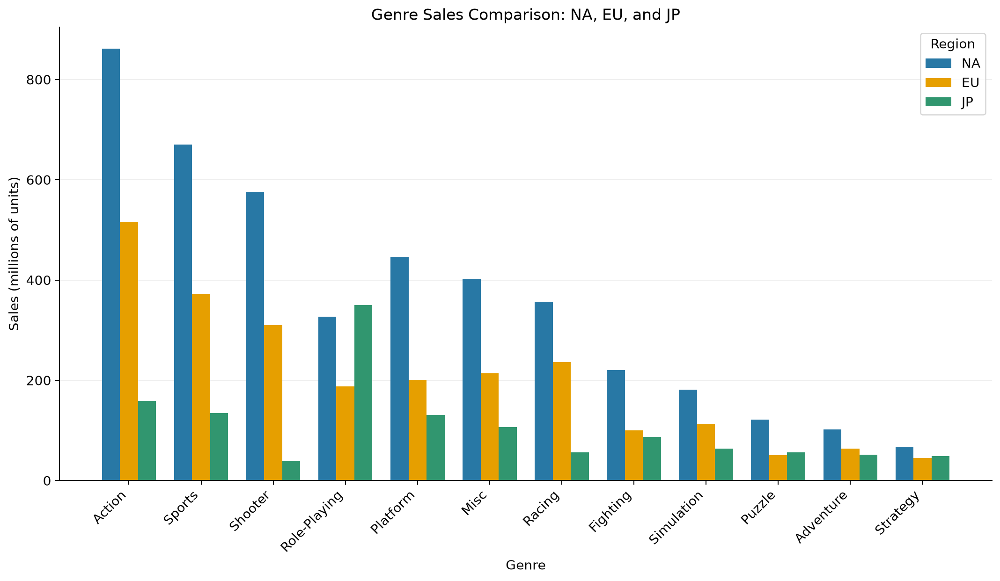

# GamePulse – Video Game Sales & Market Analysis

GamePulse is a student portfolio project that explores video game sales across
genres, platforms, publishers, release years, and regions. The objective is to
practice a complete data workflow: clean a CSV, load it into a relational database,
answer questions with SQL, and present the results in charts.

## Tech stack

Python, Pandas, MySQL/MariaDB, SQL, SQLAlchemy, PyMySQL, Matplotlib, and Git/GitHub.
Local database configuration uses python-dotenv.

## Dataset

The project uses `data/vgsales.csv`, with 16,598 rows and 11 columns. Each row
represents a game on a platform, with its rank, name, release year, genre,
publisher, regional sales, and global sales. Sales are measured in millions of
units, not revenue.

Source: [Video Game Sales by Gregory Smith on Kaggle](https://www.kaggle.com/datasets/gregorut/videogamesales),
compiled from VGChartz data.

## Data cleaning

- Started with 16,598 rows.
- Removed 271 rows with missing `Year`, leaving 16,327 rows.
- Filled 36 missing `Publisher` values in the retained rows with `Unknown`.
- Converted `Year` to an integer.
- Kept regional sales values of zero.

The result is saved as `data/vgsales_clean.csv`. The original CSV is unchanged.

## Workflow

Raw CSV → Pandas cleaning → MySQL/MariaDB → SQL analysis → Pandas → Matplotlib

## Analysis questions

1. Which genres have the highest total global sales?
2. Which platforms lead in global sales?
3. Who are the top 10 publishers by global sales?
4. How do global sales totals vary by release year?
5. How do genre sales compare across North America (NA), Europe (EU), and Japan (JP)?

## Findings and charts

### Global sales by genre

Action leads with **1,722.88 million** units globally.



### Top platforms

PS2 leads with **1,233.46 million** units globally. The chart shows the top 10 platforms.



### Top publishers

Nintendo leads with **1,784.43 million** units globally.



### Sales by release year

Games released in 2008 have the highest combined global sales at **678.90 million** units.
These totals are grouped by release year; they do not measure sales made during each calendar year.

Later years have sparse or incomplete dataset coverage. The decline near the end
should not be interpreted as a complete representation of the video game market.



### Regional genre comparison

Action leads in NA and EU, while Role-Playing leads in JP.



## Run locally

Use Python 3.10+ and a running MySQL or MariaDB server. Run these commands from the
project root.

1. Install dependencies:

   ```bash
   pip install -r requirements.txt
   ```

2. Copy `.env.example` to `.env`:

   ```bash
   cp .env.example .env
   ```

   Set your local host, port, username, password, and database name in `.env`.
   Use `gamepulse` as the database name and an account that can create and
   read/write the database and table. Both database scripts load `.env`
   automatically; existing environment variables take priority.
   Git ignores `.env`; keep it local.

3. Clean the data, load it, and create the charts:

   ```bash
   python scripts/clean_data.py
   python scripts/load_to_mysql.py
   python scripts/analyze_from_mysql.py
   ```

The loader creates the database/table and imports the cleaned CSV. Use `--replace`
only to replace all existing table rows. The analysis script only reads the
database, prints short summaries, and saves five PNG charts in `images/`.

The SQL queries are also available in `sql/analysis_queries.sql`. If you use a
database name other than `gamepulse`, update its `USE` statement before running
that file manually.

## Project structure

```text
data/
  vgsales.csv
  vgsales_clean.csv
scripts/
  clean_data.py
  load_to_mysql.py
  analyze_from_mysql.py
sql/
  create_table.sql
  analysis_queries.sql
images/                 # Five generated PNG charts
.env.example
.gitignore
requirements.txt
README.md
```
